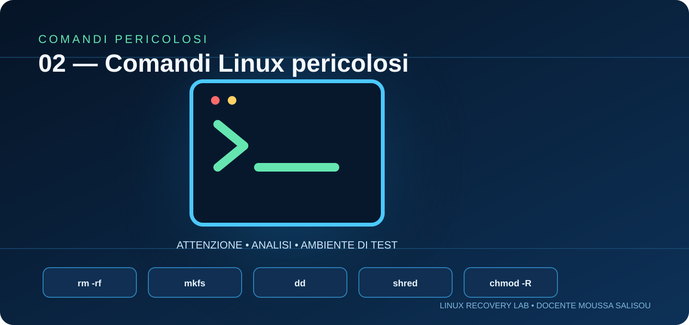

# 02 – Comandi pericolosi: riconoscimento e prevenzione

## Come leggere un comando

Un comando è composto da programma, opzioni e argomenti. Per valutarne il rischio occorre capire che cosa modifica, con quali privilegi e su quale destinazione.

### Esempio da riconoscere: rm

- `rm`: rimuove file.
- `-r`: abilita la rimozione ricorsiva delle directory.
- `-f`: forza la rimozione e sopprime alcune richieste di conferma.
- `sudo`: esegue il comando con privilegi amministrativi.
- `/`: directory radice del filesystem.

La combinazione di privilegi elevati, ricorsione e destinazione errata può rendere il danno molto esteso. Non eseguire comandi distruttivi per verificarne il comportamento.

## Famiglie di rischio

| Famiglia | Esempi da riconoscere | Rischio |
|---|---|---|
| Rimozione | `rm -rf`, `find ... -delete` | Perdita di file |
| Filesystem | `mkfs`, `fsck` correttivo | Danno o modifica filesystem |
| Scrittura raw | `dd`, `shred` | Sovrascrittura irreversibile |
| Permessi | `chmod -R`, `chown -R` | Sistema o applicazioni non funzionanti |
| Servizi | `systemctl disable` | Servizi essenziali non avviati |
| Rete/firewall | `iptables -F`, disattivazione firewall | Esposizione o perdita connettività |
| Shell remota | `curl URL | sudo bash` | Esecuzione di codice non verificato |

## Metodo di valutazione

Prima di autorizzare un comando, rispondi:
1. È in sola lettura o modifica il sistema?
2. Richiede `sudo`?
3. Qual è il percorso o dispositivo di destinazione?
4. È ricorsivo o agisce a basso livello?
5. È reversibile?
6. Esiste uno snapshot e un backup verificato?

## Alternative prudenti

- Per esaminare file: `less`, `file`, `stat`, `ls -lah`.
- Per elencare elementi prima di un'operazione: usare prima un comando senza opzioni di cancellazione.
- Per validare uno script Bash: `bash -n nome_script.sh`.
- Per verificare i dispositivi: `lsblk -f` e `findmnt`.

Queste alternative non rendono automaticamente sicura un'operazione successiva: occorre comunque verificare ogni argomento.

## Illustrazione del modulo

